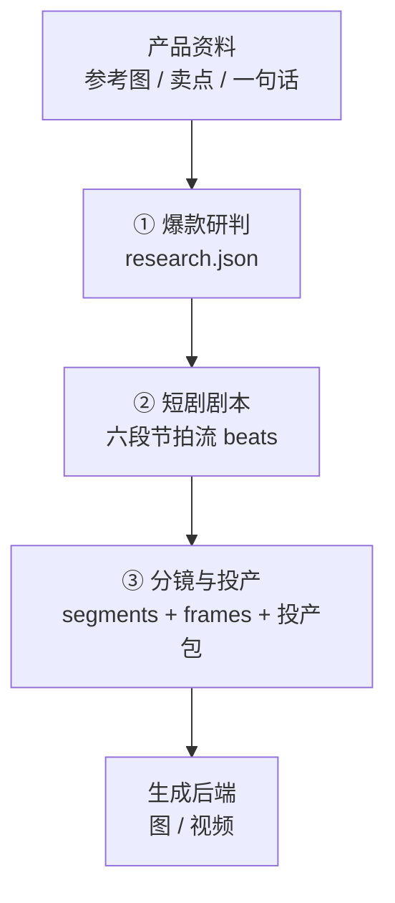

# product-drama

> 面向短视频带货的短剧智能生成框架 —— 让每一帧都服务于 **留存** 与 **转化**。

**product-drama** 是一套可由 Agent 独立调用的带货短剧生产管线。给定一份产品资料（参考图 / 核心卖点 / 一句话描述），它会先联网研判同类目中跑量最佳的视频内容结构，再依据抖音留存逻辑产出六段式短剧剧本与分镜提示词，并可在配置后对接图像 / 视频生成后端，完成从创意到成片的一站式交付。

---

## 核心能力

- **爆款研判（Research）** —— 联网定位同类目高表现视频，拆解其钩子、节奏与转化结构，沉淀为可复用的方法论资产。
- **六段剧本（Script）** —— 以「黄金 3 秒 → 冲突放大 → 解法转折 → 产品登场 → 信任锚点 → 升华 CTA」的留存结构，将卖点编排为节拍流。
- **分镜投产（Storyboard）** —— 段→切→镜头的分层拆解，输出带构图语义的分镜提示词与可下发生产的投产包。
- **可插拔生成（Generate）** —— 通过标准化后端接口，将分镜提示词转化为实际图像 / 视频素材。

## 工作流



| 阶段 | 输入 | 产出 | 关键价值 |
| --- | --- | --- | --- |
| ① 爆款研判 | 产品 / 卖点 / 链接 | `research.json` + 来源索引 | 联网沉淀同类目爆款结构，前置规避试错 |
| ② 短剧剧本 | 卖点 + 研判结论 | `drama.json.beats` | 六段留存结构 + 8 道核心质量门护航 |
| ③ 分镜与投产 | `beats` | `drama.json.segments` + 投产包 | 段→切认领，可插拔后端直出成片 |

## 六段留存结构

每一段对应一项可量化的留存 / 转化指标，结构即策略：

| 顺序 | 段落 | 优化指标 | 叙事任务 |
| --- | --- | --- | --- |
| 1 | 黄金 3 秒钩子 | 2 秒不退 | 以痛点 / 反常识 / 强冲突直击，首拍即给运动主体 |
| 2 | 放大冲突 | 5 秒完播 | 将痛点放大为具体困境，触发共鸣 |
| 3 | 解法转折 | 完播钩子 | 以人设 / 悬念 / 反差引出解法 |
| 4 | 产品登场 | 卖点可视化 | 产品出场 + 核心卖点演示 |
| 5 | 信任锚点 | 转化信任 | 效果对比 / 实测背书 / 价格锚定 |
| 6 | 升华 + CTA | 整体完播 + 转化 | 情绪升华 + 行动召唤 |

## 快速开始

```bash
# 1) 爆款研判：联网定位同类目高表现视频，产出 research.json（详见 references/research-pass.md）

# 2) 生成骨架并撰写剧本
node scripts/product-drama.mjs seed --product "控油洗发水" --seconds 45 --aspect 9:16 > drama.json
# 写满 beats 后进行质量自检
node scripts/product-drama.mjs validate drama.json

# 3) 分镜拆解 + 渲染 + 投产包导出
node scripts/product-drama.mjs render drama.json --html > drama-report.html
node scripts/product-drama.mjs export drama.json --protocol h3 --frames frames > pack.json

# 4) （可选）配置后端后实际出图 / 出片
node scripts/product-drama.mjs config --image-backend custom:<命令>
node scripts/product-drama.mjs gen drama.json --out frames
```

## 核心质量门（8 道 · 可迭代）

> 以「核心门护航、不过度锁死」为原则，保障产出质量的同时维持高速迭代。

总时长预算 ±15% · 单句台词 ≤ 35 字 · 六段结构齐全 · 钩子落于前 3 拍 · 分镜认领全覆盖 · 每段 ≤ 15 秒 · 每切 2–5 秒 · 台词可容于分镜时长。

## 自测

```bash
node scripts/selftest.mjs   # 12 项断言，不依赖模型调用
```

## 目录结构

```
.
├── SKILL.md                技能入口与调用规范
├── README.md               本文件
├── scripts/
│   ├── product-drama.mjs   确定性工具（seed / validate / checkup / render / export / gen）
│   └── selftest.mjs        不依赖模型的断言集
├── references/
│   ├── research-pass.md    爆款研判操作手册
│   ├── script-pass.md      六段剧本写法
│   ├── storyboard-pass.md  分镜写法
│   ├── h3-prompt.md        H3 多图对齐提示词（可选）
│   ├── gen-backends.md     可插拔生成后端规范
│   ├── viral-patterns.md   研判兜底模板
│   └── schema.md           JSON 数据结构定义
└── examples/               自带样例（作为质量基准）
```

## License

Apache-2.0。
